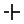
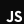
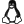
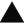
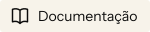

# Ícones por estrutura

[Preview interativo](https://eduardoaugustolb.github.io/assets/) · [Assets](../README.md) · [Manifesto](manifest.json) · [Direitos](../LICENSE.md)

Pequenas formas, desenhadas com o mesmo cuidado do conjunto. Esta é a versão Markdown da página de preview e documentação. Ajustes de tamanho, cor, busca e cópia estão na [versão HTML](https://eduardoaugustolb.github.io/assets/); aqui, as prévias são estáticas.

**81 ícones · SVG · 24 × 24 · 0.3.0-draft.1 · piloto em revisão.**

## Catálogo

| Preview | Nome / SVG inline | Uso no portfólio | Imagem externa |
|---|---|---|---|
| <picture><source media="(prefers-color-scheme: dark)" srcset="svg/paper/arrow-up-right.svg"></picture> | [`arrow-up-right`](svg/arrow-up-right.svg) | CTAs, links de projetos e contato | [Tinta](svg/ink/arrow-up-right.svg) · [Papel](svg/paper/arrow-up-right.svg) |
| <picture><source media="(prefers-color-scheme: dark)" srcset="svg/paper/arrow-down.svg"></picture> | [`arrow-down`](svg/arrow-down.svg) | Convite para descer ao capítulo Sobre | [Tinta](svg/ink/arrow-down.svg) · [Papel](svg/paper/arrow-down.svg) |
| <picture><source media="(prefers-color-scheme: dark)" srcset="svg/paper/arrow-up.svg"></picture> | [`arrow-up`](svg/arrow-up.svg) | Retorno ao início pelo rodapé | [Tinta](svg/ink/arrow-up.svg) · [Papel](svg/paper/arrow-up.svg) |
| <picture><source media="(prefers-color-scheme: dark)" srcset="svg/paper/plus.svg"></picture> | [`plus`](svg/plus.svg) | Detalhes dos projetos e marcas decorativas nos cantos | [Tinta](svg/ink/plus.svg) · [Papel](svg/paper/plus.svg) |
| <picture><source media="(prefers-color-scheme: dark)" srcset="svg/paper/pause.svg"></picture> | [`pause`](svg/pause.svg) | Pausar a gravura interativa e a cena da página 404 | [Tinta](svg/ink/pause.svg) · [Papel](svg/paper/pause.svg) |
| <picture><source media="(prefers-color-scheme: dark)" srcset="svg/paper/play.svg"></picture> | [`play`](svg/play.svg) | Retomar a animação após pausa | [Tinta](svg/ink/play.svg) · [Papel](svg/paper/play.svg) |
| <picture><source media="(prefers-color-scheme: dark)" srcset="svg/paper/html.svg"></picture> | [`html`](svg/html.svg) | README · HTML5 | [Tinta](svg/ink/html.svg) · [Papel](svg/paper/html.svg) |
| <picture><source media="(prefers-color-scheme: dark)" srcset="svg/paper/css.svg"></picture> | [`css`](svg/css.svg) | README · CSS3 | [Tinta](svg/ink/css.svg) · [Papel](svg/paper/css.svg) |
| <picture><source media="(prefers-color-scheme: dark)" srcset="svg/paper/javascript.svg"></picture> | [`javascript`](svg/javascript.svg) | README · JavaScript | [Tinta](svg/ink/javascript.svg) · [Papel](svg/paper/javascript.svg) |
| <picture><source media="(prefers-color-scheme: dark)" srcset="svg/paper/typescript.svg"></picture> | [`typescript`](svg/typescript.svg) | README · TypeScript | [Tinta](svg/ink/typescript.svg) · [Papel](svg/paper/typescript.svg) |
| <picture><source media="(prefers-color-scheme: dark)" srcset="svg/paper/go.svg"></picture> | [`go`](svg/go.svg) | README · Go | [Tinta](svg/ink/go.svg) · [Papel](svg/paper/go.svg) |
| <picture><source media="(prefers-color-scheme: dark)" srcset="svg/paper/python.svg"></picture> | [`python`](svg/python.svg) | README · Python | [Tinta](svg/ink/python.svg) · [Papel](svg/paper/python.svg) |
| <picture><source media="(prefers-color-scheme: dark)" srcset="svg/paper/bash.svg"></picture> | [`bash`](svg/bash.svg) | README · GNU Bash | [Tinta](svg/ink/bash.svg) · [Papel](svg/paper/bash.svg) |
| <picture><source media="(prefers-color-scheme: dark)" srcset="svg/paper/react.svg"></picture> | [`react`](svg/react.svg) | README · React | [Tinta](svg/ink/react.svg) · [Papel](svg/paper/react.svg) |
| <picture><source media="(prefers-color-scheme: dark)" srcset="svg/paper/next-js.svg"></picture> | [`next-js`](svg/next-js.svg) | README · Next.js | [Tinta](svg/ink/next-js.svg) · [Papel](svg/paper/next-js.svg) |
| <picture><source media="(prefers-color-scheme: dark)" srcset="svg/paper/astro.svg"></picture> | [`astro`](svg/astro.svg) | README · Astro | [Tinta](svg/ink/astro.svg) · [Papel](svg/paper/astro.svg) |
| <picture><source media="(prefers-color-scheme: dark)" srcset="svg/paper/vue.svg"></picture> | [`vue`](svg/vue.svg) | README · Vue.js | [Tinta](svg/ink/vue.svg) · [Papel](svg/paper/vue.svg) |
| <picture><source media="(prefers-color-scheme: dark)" srcset="svg/paper/svelte.svg"></picture> | [`svelte`](svg/svelte.svg) | README · Svelte | [Tinta](svg/ink/svelte.svg) · [Papel](svg/paper/svelte.svg) |
| <picture><source media="(prefers-color-scheme: dark)" srcset="svg/paper/tailwind-css.svg"></picture> | [`tailwind-css`](svg/tailwind-css.svg) | README · Tailwind CSS | [Tinta](svg/ink/tailwind-css.svg) · [Papel](svg/paper/tailwind-css.svg) |
| <picture><source media="(prefers-color-scheme: dark)" srcset="svg/paper/bun.svg"></picture> | [`bun`](svg/bun.svg) | README · Bun | [Tinta](svg/ink/bun.svg) · [Papel](svg/paper/bun.svg) |
| <picture><source media="(prefers-color-scheme: dark)" srcset="svg/paper/node-js.svg"></picture> | [`node-js`](svg/node-js.svg) | README · Node.js | [Tinta](svg/ink/node-js.svg) · [Papel](svg/paper/node-js.svg) |
| <picture><source media="(prefers-color-scheme: dark)" srcset="svg/paper/vite.svg"></picture> | [`vite`](svg/vite.svg) | README · Vite | [Tinta](svg/ink/vite.svg) · [Papel](svg/paper/vite.svg) |
| <picture><source media="(prefers-color-scheme: dark)" srcset="svg/paper/git.svg"></picture> | [`git`](svg/git.svg) | README · Git | [Tinta](svg/ink/git.svg) · [Papel](svg/paper/git.svg) |
| <picture><source media="(prefers-color-scheme: dark)" srcset="svg/paper/docker.svg"></picture> | [`docker`](svg/docker.svg) | README · Docker | [Tinta](svg/ink/docker.svg) · [Papel](svg/paper/docker.svg) |
| <picture><source media="(prefers-color-scheme: dark)" srcset="svg/paper/linux.svg"></picture> | [`linux`](svg/linux.svg) | README · Linux | [Tinta](svg/ink/linux.svg) · [Papel](svg/paper/linux.svg) |
| <picture><source media="(prefers-color-scheme: dark)" srcset="svg/paper/arch-linux.svg"></picture> | [`arch-linux`](svg/arch-linux.svg) | README · Arch Linux | [Tinta](svg/ink/arch-linux.svg) · [Papel](svg/paper/arch-linux.svg) |
| <picture><source media="(prefers-color-scheme: dark)" srcset="svg/paper/github-actions.svg"></picture> | [`github-actions`](svg/github-actions.svg) | README · GitHub Actions | [Tinta](svg/ink/github-actions.svg) · [Papel](svg/paper/github-actions.svg) |
| <picture><source media="(prefers-color-scheme: dark)" srcset="svg/paper/vercel.svg"></picture> | [`vercel`](svg/vercel.svg) | README · Vercel | [Tinta](svg/ink/vercel.svg) · [Papel](svg/paper/vercel.svg) |
| <picture><source media="(prefers-color-scheme: dark)" srcset="svg/paper/aws.svg"></picture> | [`aws`](svg/aws.svg) | README · Amazon AWS | [Tinta](svg/ink/aws.svg) · [Papel](svg/paper/aws.svg) |
| <picture><source media="(prefers-color-scheme: dark)" srcset="svg/paper/postgresql.svg"></picture> | [`postgresql`](svg/postgresql.svg) | README · PostgreSQL | [Tinta](svg/ink/postgresql.svg) · [Papel](svg/paper/postgresql.svg) |
| <picture><source media="(prefers-color-scheme: dark)" srcset="svg/paper/sqlite.svg"></picture> | [`sqlite`](svg/sqlite.svg) | README · SQLite | [Tinta](svg/ink/sqlite.svg) · [Papel](svg/paper/sqlite.svg) |
| <picture><source media="(prefers-color-scheme: dark)" srcset="svg/paper/redis.svg"></picture> | [`redis`](svg/redis.svg) | README · Redis | [Tinta](svg/ink/redis.svg) · [Papel](svg/paper/redis.svg) |
| <picture><source media="(prefers-color-scheme: dark)" srcset="svg/paper/figma.svg"></picture> | [`figma`](svg/figma.svg) | README · Figma | [Tinta](svg/ink/figma.svg) · [Papel](svg/paper/figma.svg) |
| <picture><source media="(prefers-color-scheme: dark)" srcset="svg/paper/blender.svg"></picture> | [`blender`](svg/blender.svg) | README · Blender | [Tinta](svg/ink/blender.svg) · [Papel](svg/paper/blender.svg) |
| <picture><source media="(prefers-color-scheme: dark)" srcset="svg/paper/three-js.svg"></picture> | [`three-js`](svg/three-js.svg) | README · Three.js | [Tinta](svg/ink/three-js.svg) · [Papel](svg/paper/three-js.svg) |
| <picture><source media="(prefers-color-scheme: dark)" srcset="svg/paper/gsap.svg"></picture> | [`gsap`](svg/gsap.svg) | README · GreenSock | [Tinta](svg/ink/gsap.svg) · [Papel](svg/paper/gsap.svg) |
| <picture><source media="(prefers-color-scheme: dark)" srcset="svg/paper/github.svg"></picture> | [`github`](svg/github.svg) | README · GitHub | [Tinta](svg/ink/github.svg) · [Papel](svg/paper/github.svg) |
| <picture><source media="(prefers-color-scheme: dark)" srcset="svg/paper/gitlab.svg"></picture> | [`gitlab`](svg/gitlab.svg) | README · GitLab | [Tinta](svg/ink/gitlab.svg) · [Papel](svg/paper/gitlab.svg) |
| <picture><source media="(prefers-color-scheme: dark)" srcset="svg/paper/linkedin.svg"></picture> | [`linkedin`](svg/linkedin.svg) | README · LinkedIn | [Tinta](svg/ink/linkedin.svg) · [Papel](svg/paper/linkedin.svg) |
| <picture><source media="(prefers-color-scheme: dark)" srcset="svg/paper/instagram.svg"></picture> | [`instagram`](svg/instagram.svg) | README · Instagram | [Tinta](svg/ink/instagram.svg) · [Papel](svg/paper/instagram.svg) |
| <picture><source media="(prefers-color-scheme: dark)" srcset="svg/paper/youtube.svg"></picture> | [`youtube`](svg/youtube.svg) | README · YouTube | [Tinta](svg/ink/youtube.svg) · [Papel](svg/paper/youtube.svg) |
| <picture><source media="(prefers-color-scheme: dark)" srcset="svg/paper/x.svg"></picture> | [`x`](svg/x.svg) | README · X | [Tinta](svg/ink/x.svg) · [Papel](svg/paper/x.svg) |
| <picture><source media="(prefers-color-scheme: dark)" srcset="svg/paper/bluesky.svg"></picture> | [`bluesky`](svg/bluesky.svg) | README · Bluesky | [Tinta](svg/ink/bluesky.svg) · [Papel](svg/paper/bluesky.svg) |
| <picture><source media="(prefers-color-scheme: dark)" srcset="svg/paper/discord.svg"></picture> | [`discord`](svg/discord.svg) | README · Discord | [Tinta](svg/ink/discord.svg) · [Papel](svg/paper/discord.svg) |
| <picture><source media="(prefers-color-scheme: dark)" srcset="svg/paper/whatsapp.svg"></picture> | [`whatsapp`](svg/whatsapp.svg) | README · WhatsApp | [Tinta](svg/ink/whatsapp.svg) · [Papel](svg/paper/whatsapp.svg) |
| <picture><source media="(prefers-color-scheme: dark)" srcset="svg/paper/telegram.svg"></picture> | [`telegram`](svg/telegram.svg) | README · Telegram | [Tinta](svg/ink/telegram.svg) · [Papel](svg/paper/telegram.svg) |
| <picture><source media="(prefers-color-scheme: dark)" srcset="svg/paper/sql.svg"></picture> | [`sql`](svg/sql.svg) | README · SQL | [Tinta](svg/ink/sql.svg) · [Papel](svg/paper/sql.svg) |
| <picture><source media="(prefers-color-scheme: dark)" srcset="svg/paper/mail.svg"></picture> | [`mail`](svg/mail.svg) | README · E-mail | [Tinta](svg/ink/mail.svg) · [Papel](svg/paper/mail.svg) |
| <picture><source media="(prefers-color-scheme: dark)" srcset="svg/paper/globe.svg"></picture> | [`globe`](svg/globe.svg) | README · Site / portfólio | [Tinta](svg/ink/globe.svg) · [Papel](svg/paper/globe.svg) |
| <picture><source media="(prefers-color-scheme: dark)" srcset="svg/paper/user.svg"></picture> | [`user`](svg/user.svg) | README · Sobre mim | [Tinta](svg/ink/user.svg) · [Papel](svg/paper/user.svg) |
| <picture><source media="(prefers-color-scheme: dark)" srcset="svg/paper/code.svg"></picture> | [`code`](svg/code.svg) | README · Tecnologias / stack | [Tinta](svg/ink/code.svg) · [Papel](svg/paper/code.svg) |
| <picture><source media="(prefers-color-scheme: dark)" srcset="svg/paper/folder.svg"></picture> | [`folder`](svg/folder.svg) | README · Projetos | [Tinta](svg/ink/folder.svg) · [Papel](svg/paper/folder.svg) |
| <picture><source media="(prefers-color-scheme: dark)" srcset="svg/paper/sparkles.svg"></picture> | [`sparkles`](svg/sparkles.svg) | README · Funcionalidades | [Tinta](svg/ink/sparkles.svg) · [Papel](svg/paper/sparkles.svg) |
| <picture><source media="(prefers-color-scheme: dark)" srcset="svg/paper/rocket.svg"></picture> | [`rocket`](svg/rocket.svg) | README · Começando | [Tinta](svg/ink/rocket.svg) · [Papel](svg/paper/rocket.svg) |
| <picture><source media="(prefers-color-scheme: dark)" srcset="svg/paper/download.svg"></picture> | [`download`](svg/download.svg) | README · Instalação | [Tinta](svg/ink/download.svg) · [Papel](svg/paper/download.svg) |
| <picture><source media="(prefers-color-scheme: dark)" srcset="svg/paper/terminal.svg"></picture> | [`terminal`](svg/terminal.svg) | README · Uso / comandos | [Tinta](svg/ink/terminal.svg) · [Papel](svg/paper/terminal.svg) |
| <picture><source media="(prefers-color-scheme: dark)" srcset="svg/paper/book-open.svg"></picture> | [`book-open`](svg/book-open.svg) | README · Documentação | [Tinta](svg/ink/book-open.svg) · [Papel](svg/paper/book-open.svg) |
| <picture><source media="(prefers-color-scheme: dark)" srcset="svg/paper/layers.svg"></picture> | [`layers`](svg/layers.svg) | README · Arquitetura | [Tinta](svg/ink/layers.svg) · [Papel](svg/paper/layers.svg) |
| <picture><source media="(prefers-color-scheme: dark)" srcset="svg/paper/settings.svg"></picture> | [`settings`](svg/settings.svg) | README · Configuração | [Tinta](svg/ink/settings.svg) · [Papel](svg/paper/settings.svg) |
| <picture><source media="(prefers-color-scheme: dark)" srcset="svg/paper/flask.svg"></picture> | [`flask`](svg/flask.svg) | README · Testes | [Tinta](svg/ink/flask.svg) · [Papel](svg/paper/flask.svg) |
| <picture><source media="(prefers-color-scheme: dark)" srcset="svg/paper/map.svg"></picture> | [`map`](svg/map.svg) | README · Roadmap | [Tinta](svg/ink/map.svg) · [Papel](svg/paper/map.svg) |
| <picture><source media="(prefers-color-scheme: dark)" srcset="svg/paper/users.svg"></picture> | [`users`](svg/users.svg) | README · Comunidade | [Tinta](svg/ink/users.svg) · [Papel](svg/paper/users.svg) |
| <picture><source media="(prefers-color-scheme: dark)" srcset="svg/paper/git-pull-request.svg"></picture> | [`git-pull-request`](svg/git-pull-request.svg) | README · Contribuição | [Tinta](svg/ink/git-pull-request.svg) · [Papel](svg/paper/git-pull-request.svg) |
| <picture><source media="(prefers-color-scheme: dark)" srcset="svg/paper/history.svg"></picture> | [`history`](svg/history.svg) | README · Changelog | [Tinta](svg/ink/history.svg) · [Papel](svg/paper/history.svg) |
| <picture><source media="(prefers-color-scheme: dark)" srcset="svg/paper/tag.svg"></picture> | [`tag`](svg/tag.svg) | README · Versões | [Tinta](svg/ink/tag.svg) · [Papel](svg/paper/tag.svg) |
| <picture><source media="(prefers-color-scheme: dark)" srcset="svg/paper/scale.svg"></picture> | [`scale`](svg/scale.svg) | README · Licença | [Tinta](svg/ink/scale.svg) · [Papel](svg/paper/scale.svg) |
| <picture><source media="(prefers-color-scheme: dark)" srcset="svg/paper/message-circle.svg"></picture> | [`message-circle`](svg/message-circle.svg) | README · Contato | [Tinta](svg/ink/message-circle.svg) · [Papel](svg/paper/message-circle.svg) |
| <picture><source media="(prefers-color-scheme: dark)" srcset="svg/paper/link.svg"></picture> | [`link`](svg/link.svg) | README · Link | [Tinta](svg/ink/link.svg) · [Papel](svg/paper/link.svg) |
| <picture><source media="(prefers-color-scheme: dark)" srcset="svg/paper/copy.svg"></picture> | [`copy`](svg/copy.svg) | README · Copiar | [Tinta](svg/ink/copy.svg) · [Papel](svg/paper/copy.svg) |
| <picture><source media="(prefers-color-scheme: dark)" srcset="svg/paper/search.svg"></picture> | [`search`](svg/search.svg) | README · Busca | [Tinta](svg/ink/search.svg) · [Papel](svg/paper/search.svg) |
| <picture><source media="(prefers-color-scheme: dark)" srcset="svg/paper/check.svg"></picture> | [`check`](svg/check.svg) | README · Concluído | [Tinta](svg/ink/check.svg) · [Papel](svg/paper/check.svg) |
| <picture><source media="(prefers-color-scheme: dark)" srcset="svg/paper/alert-triangle.svg"></picture> | [`alert-triangle`](svg/alert-triangle.svg) | README · Aviso | [Tinta](svg/ink/alert-triangle.svg) · [Papel](svg/paper/alert-triangle.svg) |
| <picture><source media="(prefers-color-scheme: dark)" srcset="svg/paper/info.svg"></picture> | [`info`](svg/info.svg) | README · Informação | [Tinta](svg/ink/info.svg) · [Papel](svg/paper/info.svg) |
| <picture><source media="(prefers-color-scheme: dark)" srcset="svg/paper/star.svg"></picture> | [`star`](svg/star.svg) | README · Favoritos | [Tinta](svg/ink/star.svg) · [Papel](svg/paper/star.svg) |
| <picture><source media="(prefers-color-scheme: dark)" srcset="svg/paper/heart.svg"></picture> | [`heart`](svg/heart.svg) | README · Apoio | [Tinta](svg/ink/heart.svg) · [Papel](svg/paper/heart.svg) |
| <picture><source media="(prefers-color-scheme: dark)" srcset="svg/paper/chart.svg"></picture> | [`chart`](svg/chart.svg) | README · Estatísticas | [Tinta](svg/ink/chart.svg) · [Papel](svg/paper/chart.svg) |
| <picture><source media="(prefers-color-scheme: dark)" srcset="svg/paper/shield.svg"></picture> | [`shield`](svg/shield.svg) | README · Segurança | [Tinta](svg/ink/shield.svg) · [Papel](svg/paper/shield.svg) |
| <picture><source media="(prefers-color-scheme: dark)" srcset="svg/paper/bug.svg"></picture> | [`bug`](svg/bug.svg) | README · Bugs | [Tinta](svg/ink/bug.svg) · [Papel](svg/paper/bug.svg) |
| <picture><source media="(prefers-color-scheme: dark)" srcset="svg/paper/hono.svg"></picture> | [`hono`](svg/hono.svg) | README · Hono | [Tinta](svg/ink/hono.svg) · [Papel](svg/paper/hono.svg) |
| <picture><source media="(prefers-color-scheme: dark)" srcset="svg/paper/fastify.svg"></picture> | [`fastify`](svg/fastify.svg) | README · Fastify | [Tinta](svg/ink/fastify.svg) · [Papel](svg/paper/fastify.svg) |
| <picture><source media="(prefers-color-scheme: dark)" srcset="svg/paper/express.svg"></picture> | [`express`](svg/express.svg) | README · Express | [Tinta](svg/ink/express.svg) · [Papel](svg/paper/express.svg) |

## Da forma ao uso

SVGs em svg/ usam currentColor para inclusão inline. Imagens externas não herdam a cor CSS: escolha ink sobre fundos claros e paper sobre fundos escuros. Tamanho e cor no preview não alteram os arquivos originais.

Catálogo expandido em revisão. Os SVGs já estão disponíveis; ainda não há pacote em registro, componentes React próprios ou adaptador Astro distribuível. Os exemplos mostram como usar os arquivos avulsos.

Os caminhos nos exemplos partem da raiz de um projeto que contém a pasta `icons/`; adapte-os ao seu consumidor. O catálogo acima usa caminhos relativos a esta pasta do repositório. Não há instalação de pacote. A consulta e a cópia técnica não substituem autorização de uso.

### HTML · SVG inline

A cor vem do CSS. O texto dá nome ao link e o ícone é decorativo.

```html
<a href="#projetos" class="project-link">
  Conhecer os projetos
  <svg aria-hidden="true" focusable="false" xmlns="http://www.w3.org/2000/svg" viewBox="0 0 24 24" width="24" height="24" fill="currentColor" color="currentColor"><g transform="rotate(45 12 12)"><path d="M5 10.75L9.88 5.87C11.05 4.7 12.95 4.7 14.12 5.87L19 10.75L17.76 11.99L12.88 7.11C12.39 6.62 11.61 6.62 11.12 7.11L6.24 11.99Z"/><path d="M11.125 9.25H12.875V20.5H11.125Z"/></g></svg>
</a>
<style>
  .project-link { color: #0b0b0b; }
  .project-link svg { width: 20px; height: 20px; }
</style>
```

### CSS · cor por máscara

Exemplo de uso com o SVG avulso. O seletor deve ser aplicado a um elemento decorativo com aria-hidden="true".

```css
.icon-arrow {
  display: inline-block;
  width: 1.25rem;
  height: 1.25rem;
  background: currentColor;
  mask: url("./icons/svg/arrow-up-right.svg") center / contain no-repeat;
  -webkit-mask: url("./icons/svg/arrow-up-right.svg") center / contain no-repeat;
}
```

### JavaScript · trocar o estado

O exemplo pressupõe um botão #motion com texto e uma imagem. Ele troca a apresentação; conecte também o estado à animação real do seu projeto.

```js
const button = document.querySelector("#motion");
const image = button.querySelector("img");
const label = button.querySelector("span");
button.addEventListener("click", () => {
  const paused = button.getAttribute("aria-pressed") !== "true";
  button.setAttribute("aria-pressed", String(paused));
  label.textContent = paused ? "Retomar animação" : "Pausar animação";
  image.src = "./icons/svg/ink/" + (paused ? "play" : "pause") + ".svg";
});
```

### Astro · imagem local

Copie a variante autorizada para public/icons/ink/. Uma imagem externa usa a cor gravada no SVG, sem herdar currentColor da página.

```astro
<a href="#projetos">
  Conhecer os projetos
  
</a>
```

### React · imagem local

Exemplo com , sem pacote React específico. Copie o SVG autorizado para o diretório público da aplicação e adapte o caminho ao seu framework.

```jsx
export function ProjectLink() {
  return (
    <a href="#projetos">
      Conhecer os projetos
      
    </a>
  );
}
```

### Markdown · README do GitHub

O caminho abaixo parte da raiz de um repositório que contém icons/. Para fundos claros, use ink; para escuros, paper. Em outros repositórios, copie o SVG autorizado ou use uma URL raw fixada em commit.

```md
<picture>
  <source media="(prefers-color-scheme: dark)"
          srcset="icons/svg/paper/arrow-up-right.svg">
  
</picture>
```

## Forma com intenção

Curvas contidas, terminais retos e cortes por espaço negativo. Pictogramas autorais usam grade de 24 unidades. Logos de terceiros preservam a geometria de origem, com créditos e condições próprios.

Os SVGs não contêm imagens raster, fontes, scripts ou recursos externos. A leitura foi inspecionada em tamanhos pequenos, mas não houve teste de compreensão com público. Os cortes têm menor definição em 13 px, reservado a decoração no portfólio; priorize 16 px ou mais nos usos funcionais.

## Acessibilidade

Quando houver texto equivalente no controle, trate o ícone como decorativo: aria-hidden="true" no SVG inline ou alt="" em uma imagem. Se o ícone comunicar informação sozinho, dê um nome acessível ao controle ou um texto alternativo à imagem. Foco, alvo de toque e estado pertencem ao controle.

## Tags, badges e README

Categoria + todas as tags selecionadas + busca são combinadas por E. “Limpar filtros” remove categoria, tags e busca. A busca ignora acentos/maiúsculas e inclui aliases PT-BR/EN. Vocabulário com IDs em minúsculas/kebab-case no [manifesto](manifest.json).

- `3d`: 3D
- `architecture`: Arquitetura
- `author`: Sobre / about
- `backend`: Backend
- `community`: Comunidade
- `contact`: Contato / contact
- `database`: Banco de dados
- `design`: Design
- `devops`: DevOps
- `docs`: Docs
- `documentation`: Documentação
- `email`: E-mail
- `framework`: Framework
- `frontend`: Frontend
- `git`: Git
- `installation`: Instalação
- `interface`: Interface
- `javascript`: JavaScript
- `language`: Linguagem
- `license`: Licença
- `media`: Mídia
- `navigation`: Navegação
- `package-manager`: Gerenciador de pacotes
- `planning`: Planejamento
- `readme-section`: Seções de README
- `repository`: Repositório
- `runtime`: Runtime
- `security`: Segurança
- `social`: Redes sociais
- `statistics`: Estatísticas
- `status`: Estados
- `technology`: Tecnologias / stack
- `testing`: Testes
- `typescript`: TypeScript
- `version`: Versões
- `website`: Site

Badges têm altura de 32 px, ícone de 20 px e Instrument Sans em contornos, sem depender de fontes instaladas. Temas light (papel/tinta) e dark (tinta/papel). O catálogo oferece cópia de Markdown, HTML e URL para ambos os formatos. URLs apontam a main; para congelar a versão, substitua main pelo SHA do commit após publicação.

### Stack


### Links sociais

[](https://github.com/eduardoaugustolb)

### Cabeçalho de seção e temas

<picture>
  <source media="(prefers-color-scheme: dark)" srcset="badges/dark/book-open.svg">
  
</picture>

Os exemplos foram preparados para imagens estáticas no GitHub; validação remota em ambos os temas depende da publicação dos novos arquivos.

## Direitos de uso

Todos os direitos reservados sobre ícones e código próprios. Logos de terceiros têm créditos e condições no manifesto e em icons/THIRD-PARTY.md. A disponibilidade pública e os botões de cópia não concedem licença geral de reutilização dos desenhos próprios. Obtenha autorização do titular antes de usar os materiais. As fontes desta página têm licença SIL OFL própria.

Logos de terceiros seguem [créditos e condições próprios](THIRD-PARTY.md), com origem, versão, diretrizes e licenças individuais no manifesto. Não são desenhos autorais de Eduardo Augusto.

[Condições completas](../LICENSE.md) · [Fontes e licenças da página](../site/fonts/) · [Portfólio](https://eduardoaugusto.work/)
